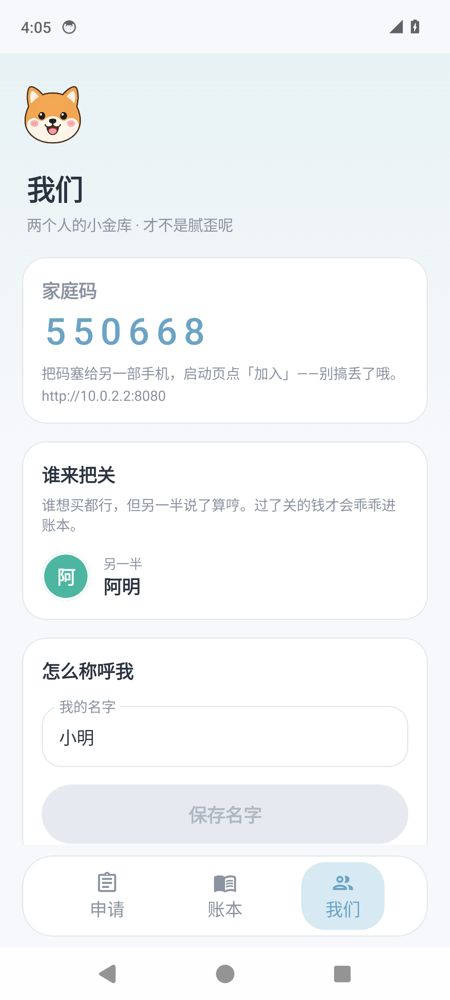

# 哒哒（DaDa）

两人共享的小空间：经期记录、旅行足迹和桌面组件。**数据存在自己的后端**，两部手机用同一个家庭码同步。

应用身份：桌面名 **哒哒**（英文环境 **DaDa**），`applicationId` 仍为 **`com.guanguanhua.app`**。改名只动了显示名，包名、签名、`versionCode` 规则都没动，所以新版本是**覆盖安装**在现有 App 上，手机上不会多出一个图标、数据也不丢。旧的 `com.savemoney.app`（省钱助手）是另一个应用身份，需要单独装新包或卸载。

- 记录经期开始和结束，预测下次，并提前提醒
- 开始一段**旅程**，记下每一站（住宿、美食、风景、博物馆、杂物店），可加评分、消费、照片和路线
- **桌面组件**：每个家庭一张共享照片和一句说明（叠在照片正中间，可设颜色）；谁改了，两部手机的小组件一起变。详见 **[docs/widget.md](docs/widget.md)**。
- 经期提醒和旅程结束提醒走**系统状态栏通知**（需授予通知权限）；App 打开时每 30 秒同步一次，后台大约每 15 分钟同步一次小组件。不依赖 Google 推送。部分手机厂商会限制后台任务，需允许自启动/关掉电池优化。

## 两部手机怎么一起用

1. 打开 App，默认连生产服务器 `http://xxxxx`，不用填地址。
2. 第一部手机打开「我们」，填自己的名字，点 **创建家庭**，记下 6 位家庭码。
3. 第二部手机同样打开「我们」，填名字，输入家庭码，点 **加入**。
4. 每个家庭**暂时最多两个人**。在「编辑资料」点「退出这个家庭」只让这台手机退出登录，**不会删**服务器上的身份、经期和足迹。再用家庭码加入：名字对得上就回到原来的身份；已经有两个人且名字对不上时，会列出这两人的名字和头像，点选其中一个进入（沿用对方的登录令牌，没有密码）。
5. 之后两边的经期、足迹、头像和桌面组件都会同步；在「我们」页可以看到家庭码，改名字/头像走 **编辑资料**。
6. 桌面组件：打开「我们 → 编辑桌面组件」上传一张合照、写一句说明（建议 ≤40 字，叠在照片正中间，可设颜色），再把「哒哒」小组件加到桌面。空状态是「还没有照片」。相册上传会先压成 JPEG。怎么加、以及 `GET/PATCH /api/widget`、`POST/DELETE /api/widget/image`：见 **[docs/widget.md](docs/widget.md)**。

若库里已经有超过两人的旧家庭，加入选择器只列出**当前还在的成员**，不会自动删人；需要的话请在服务器上手动清理多余成员。

调试时若要连本机后端，可在「我们」页（未加入时）或「编辑资料」里改服务器地址（模拟器用 `http://10.0.2.2:8080`）。同一 Wi‑Fi 下也可用电脑的局域网 IP。

## 启动后端

需要 Node.js 22+。

```bash
cd backend
npm install
npm start
```

或：

```bash
cd backend && docker compose up --build
```

模拟器访问电脑上的后端请用 `http://10.0.2.2:8080`。

## 构建 App

```bash
./gradlew assembleDebug
./gradlew testDebugUnitTest
```

需要 JDK 17+ 与 Android SDK（compileSdk 35）。未用 Android Studio 时，在根目录 `local.properties` 写入 `sdk.dir=/path/to/android-sdk`。

调试包默认输出：`app/build/outputs/apk/debug/app-debug.apk`。

## 版本号与覆盖安装

每次给已经装过的手机再装一包，**`appVersionCode` 必须比手机上的大**，否则系统会拒绝覆盖。数字写在根目录 `gradle.properties`：

```
appVersionCode=4
appVersionName=1.1.2
```

改完再 `./gradlew assembleDebug`。也可以临时覆盖，不必改文件：

```bash
./gradlew assembleDebug -PappVersionCode=3 -PappVersionName=1.1.1
```

推到 `main` 时 GitHub Actions 会用 `versionCode = 1000 + run_number`、`versionName = 1.2.{run_number}`，不改仓库里的这两个数字。服务器上的下载文件名仍是 `saveMoney.apk`（`/api/update/download/saveMoney.apk`），这只是服务器上的文件名，桌面显示的是「哒哒」；不要改它，以免阿里云的应用内更新失效。

### 改名字 / 改图标不会变成新 App

覆盖安装（更新而不是装第二个 App）只取决于三件事：**`applicationId` 不变、签名不变、`versionCode` 变大**。

- 改桌面名（`app_name` / `widget_name`）、图标、主题、页面文案都只是资源，随便改，更新照样覆盖。
- 唯一不能动的是 `app/build.gradle.kts` 里的 `applicationId = "com.guanguanhua.app"`。动了它（历史上 `com.savemoney.app → com.guanguanhua.app` 那次）系统就会当成另一个 App，只能重新装。
- 签名也别换：CI 用固定的 `ANDROID_KEYSTORE_*`；本机直接装 `assembleDebug` 的包时用的是默认 debug keystore。**同一个手机上要么一路装 CI 包，要么一路装本机 debug 包**，混装会报签名冲突。

## 应用内检查更新（自家服务器）

App 在「我们」页可以「检查更新」；进家庭后每天最多自动查一次，有新版本才提醒。它请求的是**当前配置的 API 地址**：

`GET {serverUrl}/api/update/latest`

例如生产环境：`http://xxxxx/api/update/latest`。

返回 JSON：

```json
{
  "versionCode": 3,
  "versionName": "1.2.0",
  "apkUrl": "/api/update/download/saveMoney.apk",
  "notes": "修了点小毛病"
}
```

`apkUrl` 可以是相对路径（相对 `serverUrl`）或完整 URL。手机用 `versionCode` 和本地 `PackageInfo` 比较，更大才提示下载安装。

### 怎么发版

生产环境推 `main` 即可（见下方 GitHub Actions）。本地手动发版：

1. 把 `gradle.properties` 里的 `appVersionCode` / `appVersionName` 调高，再 `./gradlew assembleDebug`（或 release）。
2. 把 APK 拷进数据目录的 `updates/`，并写 `latest.json`。**换文件即可，不用重启后端。**

`latest.json` 示例：

```json
{
  "versionCode": 3,
  "versionName": "1.2.0",
  "filename": "saveMoney.apk",
  "notes": "修了点小毛病"
}
```

本地 / 未设环境变量时，数据目录是 `backend/data`：

```bash
backend/scripts/publish-update.sh app/build/outputs/apk/debug/app-debug.apk 3 1.2.0 "修了点小毛病"
```

### 阿里云自动部署（GitHub Actions）

推送到 `main`，或在 Actions 里手动 **Run workflow**，会 SSH 部署后端、打 `saveMoney.apk`，并发布到服务器 `updates/`。

**必填 Secrets（精确名称）：** `DEPLOY_HOST`、`DEPLOY_USER`、`DEPLOY_SSH_KEY`，以及 APK 固定签名用的 `ANDROID_KEYSTORE_BASE64`、`ANDROID_KEYSTORE_PASSWORD`、`ANDROID_KEY_ALIAS`、`ANDROID_KEY_PASSWORD`  
**可选：** `DEPLOY_PATH`（不设则用服务器上已有的 `~/watchMoney` 或 `~/saveMoney`，否则 clone 到 `~/watchMoney`）

`ANDROID_KEYSTORE_BASE64` 是 **keystore 文件**的 base64（建议单行、无换行），不要把 `.jks` / 密码 / 这段 base64 提交进仓库。本地 `assembleDebug` 不设这些变量时仍用默认 debug 签名。详细生成步骤见 **[docs/deploy.md](docs/deploy.md)**。

首次需要服务器已安装 Docker、git、curl，并建好数据目录 `/data/savemoney`（重建容器也不会删数据）。完整步骤、密钥怎么配、从旧 compose 迁数据：见 **[docs/deploy.md](docs/deploy.md)**。

生产健康检查 / 最新版本：

```bash
curl http://xxxxx/api/health
curl http://xxxxx/api/update/latest
```

确认 JSON 后，手机上打开「我们」→「检查更新」。安装时如系统要求，需要允许「哒哒」安装未知应用。

**从旧包 `com.savemoney.app` 换过来：** 那是另一个应用身份，系统不会覆盖安装。装上新包后按需卸载旧的「省钱助手」；家庭和记录在服务器上，用同一家庭码重新加入即可。之后同一 `applicationId`（`com.guanguanhua.app`）的更新都走覆盖安装。

## 界面截图

| 我们俩 |
| --- |
|  |

## 技术栈

- App：Kotlin 2.0 · Jetpack Compose · Retrofit
- 后端：Node.js（Express）· SQLite · 本地文件存照片
- minSdk 26，compileSdk / targetSdk 35
